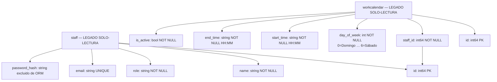

# work-schedule — Diagrama de Base de Datos

> **No se permite DDL.** Las tablas son propiedad del sistema legado.
> Estrategia de lectura: primero obtener `staff` por `staff_id`, luego obtener todas
> las filas de `workcalendar` para ese personal ordenadas por `day_of_week ASC`.
